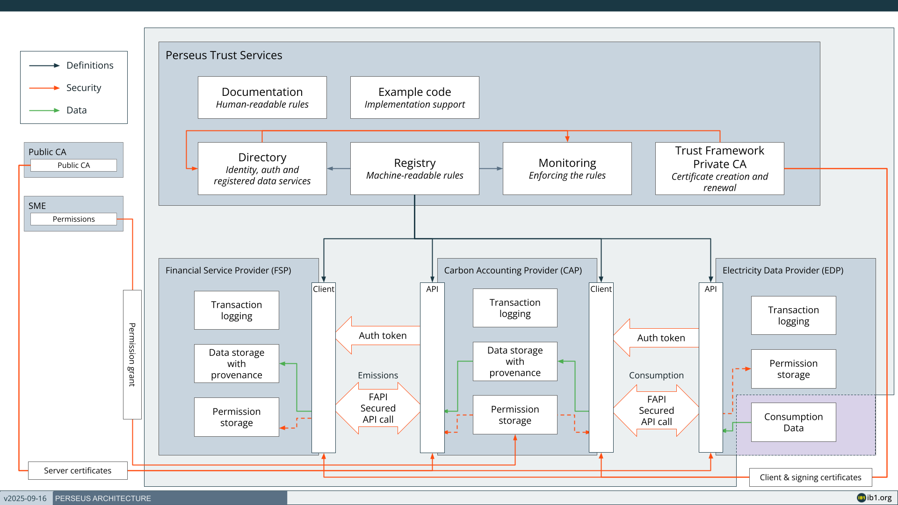
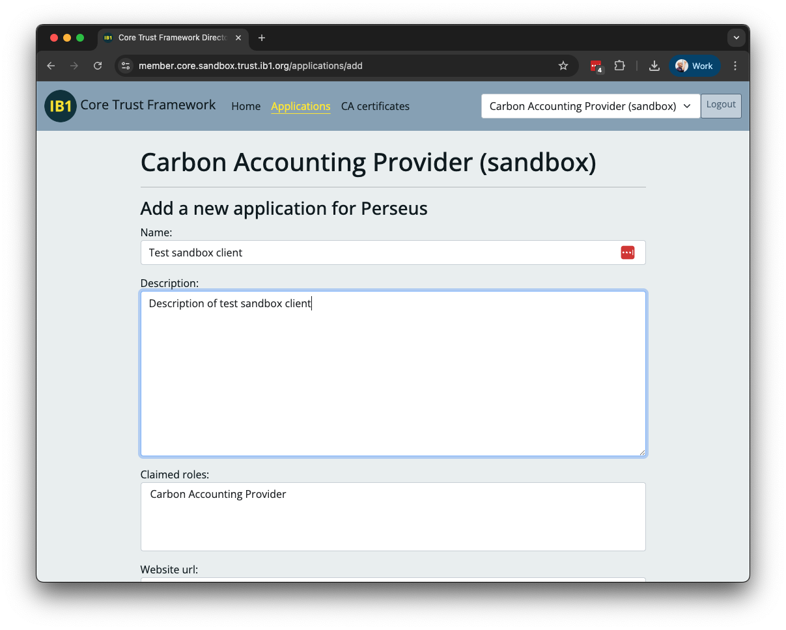
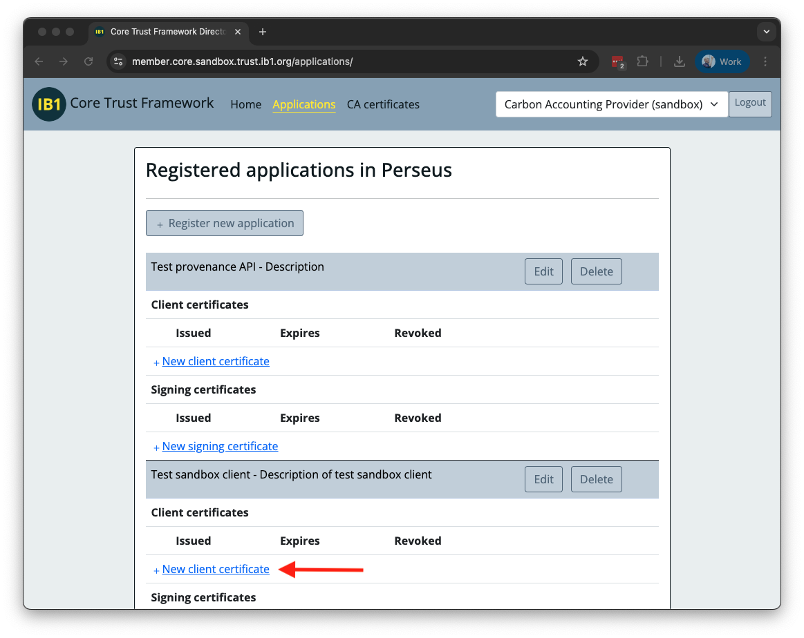
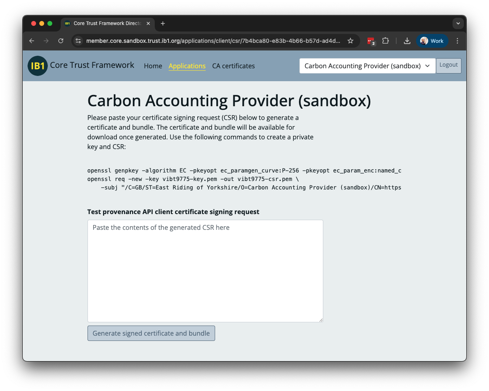

# Common Technical Guide

## Architecture overview

## Demo web applications

Icebreaker One has published demonstration energy data provider (EDP) and carbon accounting provider (CAP) implementations in Python. Our intention is for the code and README there to be self-describing. Please use the GitHub Issues feature on the repository if you have any questions or encounter problems.

[https://github.com/icebreakerone/perseus-demo-energy](https://github.com/icebreakerone/perseus-demo-energy)
[https://github.com/icebreakerone/perseus-demo-cap](https://github.com/icebreakerone/perseus-demo-cap)

## Generate certificates

When your organization completes the Core Trust Framework agreement (see [Legal](legal-and-operational.md)) IB1 will review the information provided and create an organization record in the Sandbox and Production member portals within two working days, then invite your administrative contacts to create user accounts on them.

IB1 or your own organisation administrator will send an invitation to create an account on the **Sandbox** member portal at [https://member.core.sandbox.trust.ib1.org](https://member.core.sandbox.trust.ib1.org)

You will need to set a password and provide a 2nd method of authentication via text message or authenticator application.

Once configured, log into the member portal and navigate to the Perseus scheme.

If you have not already done so, create a new Application within the Perseus scheme.

You may choose the application name, but ensure it is clear and recognisable to external audiences, as it will appear publicly in the Directory and on issued certificates.

Create a **Client certificate** and a **Signing certificate**. For each, follow the instructions in the Directory to create a CSR with openssl and upload it for signing to the Directory.

Use a separate private key for each certificate, and store them securely.

Detailed documentation of Perseus certificates may be found in the[Member Identity Digital Certificates](https://specification.docs.ib1.org/member-identity-digital-certificates/1.0/) specification.

### Checking certificates

The Core Trust Framework Directory provides a tool to check the validity and view the content of client and signing certificates. To confirm participant information you must use the Directory for the environment the certificate is issued from (Sandbox or Production). The viewer may be found at:

- Sandbox: [https://directory.core.sandbox.trust.ib1.org/tools/certificate-viewer/](https://directory.core.sandbox.trust.ib1.org/tools/certificate-viewer/)
- Production: [https://directory.core.trust.ib1.org/tools/certificate-viewer/](https://directory.core.trust.ib1.org/tools/certificate-viewer/)

### Intermediate renewal

The Directory issues member certificates from intermediate CA certificates, one for client certificates and one for signing certificates. The intermediates are replaced every year. The root CA certificates do not change.

Each intermediate issues certificates for one year, then stays valid for a further year without issuing. This means a certificate issued on an intermediate's last issuing day is still valid for its full term. While a new intermediate is issuing, the previous one is still valid, so there are two valid intermediates of each type at any time.

IB1 will notify members before a new intermediate starts issuing. The new intermediates can be downloaded from:

- the **CA certificates** page of the member portal for an environment
- Without logging in: `/ca/client` and `/ca/signing` of the Directory for an environment
- With the Directory CLI: `directory ca download client` and `directory ca download signing`

**Existing certificates**

Certificates issued by the previous intermediate stay valid until their own expiry date. You do not need to reissue them.

**Client certificates (mTLS)**

- If you accept mTLS connections, for example as an energy data provider, add the new client intermediate to your trust store before it starts issuing. Keep the previous intermediate in your trust store until it expires, as members will still present certificates it issued.
- When you renew your client certificate, it will be issued by the new intermediate. Configure your client to present your certificate together with the intermediate that issued it.

**Signing certificates (provenance)**

- When you renew your signing certificate, it will be issued by the new intermediate. Sign provenance records with your certificate followed by its new intermediate, so the record carries the full chain.
- If you verify provenance records, verify against the signing root CA certificate. Records include the intermediate that issued each signer's certificate, so no change is needed when intermediates are renewed.

**After the previous intermediate expires**

Every certificate the previous intermediate issued will have expired by then, so you can remove it from your trust stores.

## Identifiers

The Trust Framework uses Registry URLs as identifiers to discover APIs and other Members in the Directory. These URLs will vary between environments, both the hostname in the URL and any version number in the URL path.

**Sandbox**

- Registry hostname: `https://registry.core.sandbox.trust.ib1.org`
- Directory hostname: `https://directory.core.sandbox.trust.ib1.org`

**Production**

- Registry hostname: `https://registry.core.trust.ib1.org`
- Directory hostname: `https://directory.core.trust.ib1.org`

You should write your application with a configuration that allows the entire URL to be varied between environments.
